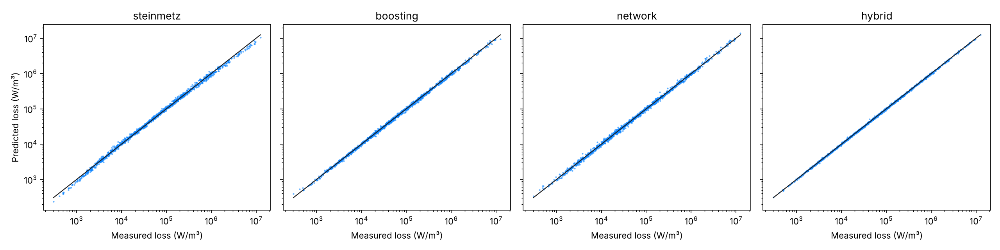
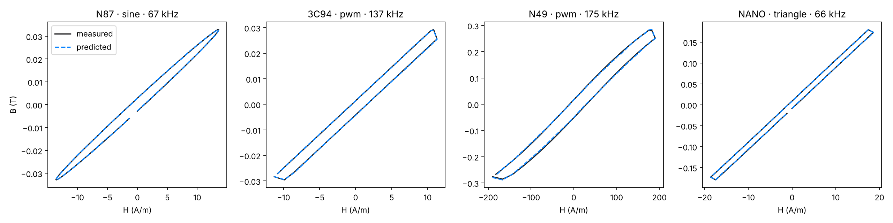

# Magnetic Core Loss Studio

Physics-guided machine learning for magnetic core-loss and B–H loop prediction. The project compares a classical Steinmetz / iGSE baseline with gradient boosting, a neural network and a hybrid model that learns a multiplicative correction on top of the physics, and serves them through a REST API and an interactive dashboard.

## Highlights

- Steinmetz and improved generalized Steinmetz (iGSE) baseline fitted per material and temperature band
- Gradient boosting and feed-forward network predicting log10 core loss
- Hybrid model: `P = P_steinmetz · exp(Δ_ML)`
- Neural B–H loop reconstruction with loop-area loss as a physical consistency check
- Evaluation on unseen frequency, temperature, waveform and material
- FastAPI backend and Streamlit dashboard

## Results

Mean absolute percentage error on core loss, trained on 80 percent of the data or on the conditions left in each split.

| Split | Steinmetz | Boosting | Network | Hybrid |
|---|---|---|---|---|
| random | 7.7 | 5.1 | 6.5 | 2.8 |
| unseen frequency | 12.4 | 16.2 | 13.0 | 3.5 |
| unseen material | 16.7 | 19.2 | 61.5 | 15.6 |
| unseen temperature | 7.3 | 5.8 | 16.9 | 4.3 |
| unseen waveform | 7.9 | 6.3 | 119.7 | 2.8 |

The hybrid model is the most accurate on every split. Unseen material remains the hardest case, where all models stay above 15 percent error. Loop reconstruction reaches a B RMSE below 1 mT with under 1 percent loop-area error. Full tables are in `reports/`.




## Data

The repository ships with a reproducible synthetic dataset covering four materials (three ferrites and one nanocrystalline alloy), four waveforms, 50–500 kHz, 25–120 °C and 20–300 mT. It is generated from a nonlinear loss law with frequency–flux interaction, a thermal minimum and iGSE waveform scaling, plus a rate-dependent tanh hysteresis model for B–H loops. All rows are labelled `source = synthetic`.

Results on synthetic data demonstrate the method, not material truth. To use measurements, provide `data/raw/measurements.csv` and `data/processed/loop_sequences.npz` in the same schema and skip dataset generation in `train.py`.

## Quick start

```bash
python -m venv .venv && source .venv/bin/activate
make install
make train
make test
make api
make app
```

API documentation is served at `http://localhost:8000/docs`.

```bash
curl -X POST http://localhost:8000/predict \
  -H "Content-Type: application/json" \
  -d '{"material": "N87", "frequency_hz": 100000, "temperature_c": 90, "b_peak_t": 0.1, "waveform": "triangle"}'
```

## Structure

```
app/dashboard.py          Streamlit front end
src/magnetic_ml/
  physics.py              waveforms, Steinmetz, iGSE, loop area
  data.py                 synthetic data generation
  features.py             feature engineering
  models.py               baseline, boosting, network, hybrid, loop model
  evaluation.py           metrics and generalization splits
  train.py                experiments, figures, model bundle
  service.py              prediction service
  api.py                  FastAPI backend
tests/                    physics and pipeline tests
```

## Method notes

- Targets are log10 core loss because loss spans several orders of magnitude.
- Features are derived from each sample's own waveform, and splits are made per operating condition so no loop is shared between train and test.
- Out-of-range inputs raise a warning in both the API response and the dashboard.
# magnetic-hysteresis-ml
# magnetic-hysteresis-ml
